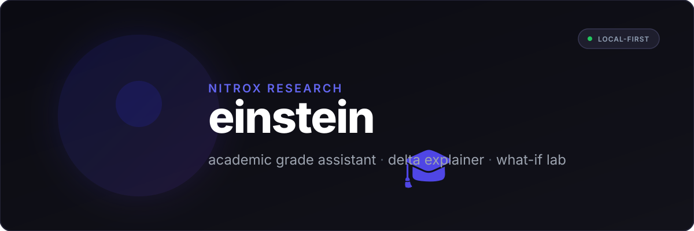
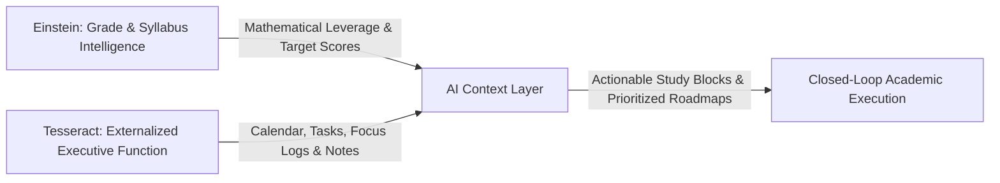

<p align="center">
  
</p>

<p align="center">
  <strong>Stop staring at unexplained numbers. Start understanding your grades.</strong><br>
  A file-first, local-first grade assistant that explains what changed and why — with a real-time What-If Lab for the assignments you haven't turned in yet.
</p>

<p align="center">
  <a href="https://discord.gg/P8pTEhAwD4"></a>
  <a href="https://github.com/nitroxhq/einstein"></a>
  <a href="https://nitroxhq.github.io/"></a>
  <a href="https://github.com/nitroxhq/einstein/blob/main/LICENSE"></a>
</p>

---

## 💡 Overview

Learning is an iterative feedback loop: you allocate effort, submit work, observe the result, and calibrate your next move. But modern institutional grade portals (Canvas, Blackboard, PowerSchool, Infinite Campus) break this cycle into a disconnected **open circuit**. They dump delayed, isolated percentages onto dashboards weeks after submission with zero causal context—leaving students paralyzed between backward anxiety and forward guesswork.

Einstein repairs this broken circuit across all three stages of academic evaluation:

### 1. The Backward Loop: Decomposing What Just Happened
Portals report raw numerical changes, but never explain why the math actually moved:
- *“Why did my overall course standing drop 2.4% after scoring an 88% on an exam?”*  
  Because that exam sits in a category worth 40% of your grade with only one prior test entered—so even a solid 88% drags down your existing 96% homework average.
- *“Did my grade drop because I did poorly, or did the teacher just enter a zero for something I haven't turned in yet?”*  
  Portals frequently throw a zero into the total point pool the minute an assignment is created, making it look like your grade plummeted when the deadline hasn't even passed.
- *“How did the professor’s curve actually affect my standing?”*  
  Curving isn't always a flat point bump. Sometimes it scales the class mean or shifts grade boundaries, meaning a raw 78% might quietly put you in solid B+ territory without the gradebook showing you why.

### 2. The Present Loop: Resolving Hidden Syllabus Mechanics
Static dashboards show an incomplete picture whenever syllabi use real-world grading rules:
- *“If the syllabus drops my lowest two quiz scores at the end of the term, what is my actual standing right now?”*  
  Most gradebooks don't apply drop rules until final grades are submitted in December—so your portal shows an artificially depressed average all semester long that doesn't reflect where you actually stand.
- *“Is this class graded on weighted category percentages or cumulative total points?”*  
  A 100-point lab sounds huge until you realize labs are only 10% of your grade, while a 25-point quiz in a 50% category quietly swings everything. Einstein untangles how points actually translate to final percentage impact.
- *“Is my current grade mathematically safe, or could one bad score tank it?”*  
  Early in the semester, a 96% average can give you false confidence if it's based entirely on easy homework assignments while heavily weighted exams haven't been entered yet.

### 3. The Forward Loop: Steering Upcoming Effort & Trajectory
Portals offer zero forward-looking intelligence to guide how you study or prioritize your week:
- *“What do I actually need to score on the remaining midterms and final to walk away with an A?”*  
  Instead of guessing numbers on a napkin or playing trial-and-error with spreadsheets, Einstein solves the backward math across all remaining assignments to give you your exact score targets.
- *“Can I realistically recover from bombing Midterm 1, or is an A mathematically out of reach?”*  
  Sometimes you can still pull an A if enough points remain; other times, the category weights make it mathematically impossible even with a perfect score on everything left. Einstein gives you the honest math upfront so you don't waste energy on false hope.
- *“Where does my study time actually matter most tonight?”*  
  Spending four hours polishing a homework assignment worth 0.5% of your final grade is poor leverage if you have a quiz tomorrow that swings 15%. Einstein highlights which upcoming deadlines have the highest leverage over your GPA.
- *“What happens if I take a calculated B in Organic Chemistry so I can guarantee an A in Calculus?”*  
  Your classes don't exist in isolated silos. Einstein lets you simulate cross-course trade-offs so you can invest your study hours where they protect your overall semester GPA the most.

**Einstein** closes this broken feedback loop. Designed around Nitrox’s core principles of **file-first data ownership**, **local-first privacy**, and **deliberate friction removal**, Einstein turns opaque institutional gradebooks into clear, self-correcting intelligence—empowering students to understand every past grade shift and accurately forecast every upcoming move.

---

## 🧠 Core Architectural Pillars

1. **The Delta Explainer Engine**  
   Grades change constantly, but portals never explain *why*. Einstein audits every grade adjustment and provides a natural-language breakdown of category weight impact, syllabus curve shifts, and score deviations.

2. **The What-If Lab**  
   Simulate hypothetical outcomes before you take an exam or turn in a project. Calculate the exact point threshold needed on upcoming deliverables to maintain or achieve your target GPA.

3. **File-First & Local-First Freedom**  
   Your academic record belongs to you. Einstein stores your course data, syllabi breakdowns, and grade histories locally in open, human-readable formats (JSON and Markdown). No vendor lock-in, no remote cloud silos.

4. **Zero-Friction Privacy**  
   Student data is sensitive. Einstein runs offline-first with zero tracking, telemetry, or data harvesting. Your school credentials and performance metrics never leave your machine.

---

## ✨ Feature Comparison

Einstein replaces fragmented web calculators, school-locked mobile clients, messy spreadsheets, and clunky LMS grade tabs:

| Capability | Standard LMS (Canvas, Blackboard, PowerSchool) | Ad-Hoc Calculators (RogerHub, Excel sheets) | Other Grade Calculators (GradeWay, [Gradiate](https://gradiate.app/)) | **Einstein** |
| :--- | :--- | :--- | :--- | :--- |
| **Delta Explanation** | ❌ Just displays raw number changes | ❌ No historical tracking | ⚠️ Trend lines & change logs (no causal breakdown) | ✅ **Full plain-English impact breakdown** |
| **What-If Simulation** | ⚠️ Clunky or read-only | ⚠️ Single isolated formulas | ⚠️ In-app score mocking (tied to portal sync) | ✅ **Multi-course interactive sandbox** |
| **Category Weight Math** | ❌ Opaque category grouping | ⚠️ Requires manual formula setup | ⚠️ Syncs LMS categories; limited custom curve math | ✅ **Automatic weight & points resolution** |
| **Drop-Lowest Rules** | ⚠️ Frequently miscalculated | ❌ Manual spreadsheet logic | ⚠️ Mirrors LMS rules; often bypassed in what-ifs | ✅ **Automated dynamic drop recalculations** |
| **Data Privacy** | ❌ School-managed surveillance | ⚠️ Ad-supported websites | ⚠️ Third-party apps require school portal logins | ✅ **100% local-first & offline** |
| **Open File Formats** | ❌ Locked in institutional databases | ⚠️ Proprietary spreadsheet formats | ❌ Proprietary mobile app cache / closed data | ✅ **Human-readable JSON/Markdown** |
| **Platform Freedom** | ❌ Institutional portal lock-in | ✅ Standalone web tools | ❌ Limited to supported LMSs (HAC, PowerSchool) | ✅ **100% portal-agnostic & self-contained** |
| **Actionable Insights** | ❌ None | ❌ None | ⚠️ Basic GPA goals & push notification alerts | ✅ **Target score trajectories & alerts** |

---

## 🧪 The What-If Lab

The **What-If Lab** is Einstein's flagship simulation environment:

- **Target Grade Solver:** Tell Einstein: *"I need a 90.0% in Organic Chemistry."* Einstein solves the backward equation across all remaining weighted assignments to give you the exact score required.
- **Scenario Comparison:** Test multiple scenarios side-by-side (e.g. *Optimistic*, *Expected*, *Safety Margin*).
- **Extra Credit & Curve Modeling:** Experiment with custom syllabus curves, bonus point systems, and scale offsets.
- **Assignment Weight Sensitivity:** Visual indicator showing which upcoming assignments have the highest mathematical leverage over your final grade.

---

## 🔄 The Complete Academic Loop: Einstein × Tesseract Integration

While Einstein solves the mathematical and analytical side of your grades, academic success requires connecting those calculations to daily action.

In the Nitrox ecosystem, **[Tesseract](https://github.com/nitroxhq/tesseract)** serves as your all-in-one cognitive workspace—externalizing executive function across tasks, calendar scheduling, time tracking, habit formation, spaced repetition flashcards, notes, and infinite canvas whiteboards.

Upcoming integrations between **Einstein** and **Tesseract** will close the ultimate feedback loop between **quantitative grade analysis** and **operational execution**:



### 1. Connecting Grade Leverage to Executive Action
Einstein’s What-If engine identifies exactly *where* your effort matters most (e.g. *"Your upcoming Physics final accounts for 35% of your grade, requiring an 84% to secure an A-"*). When integrated with Tesseract, this quantitative insight directly triggers executive support:
- **Automatic Task Prioritization:** Assignments with the highest grade leverage are prioritized in your Tesseract task backlog.
- **Dynamic Calendar Time-Blocking:** Tesseract can automatically suggest and reserve focused study blocks leading up to high-sensitivity exams.
- **Adaptive Spaced Repetition (SRS):** Study decks in Tesseract are weighted and scheduled to match the syllabus milestones and exam dates tracked in Einstein.

### 2. Giving You and AI Full Cognitive Context
Modern AI assistants are typically handicapped by fragmented context—they either see a disconnected to-do list or an isolated grade number. Through Einstein and Tesseract's shared **file-first, local-first architecture**, your personal AI gains full qualitative and quantitative context across your entire academic life:
- **The Stakes (Einstein):** Exact category weight distributions, drop-lowest policies, syllabus curve offsets, and required grade thresholds.
- **The Bandwidth (Tesseract):** Open calendar hours, energy levels, active project deadlines, notes, and historical time tracking data.

With this unified context, your AI evolves from a generic text generator into an intelligent academic strategist—capable of answering questions like:
> *"Einstein calculates that your Organic Chemistry exam carries 3× the grade leverage of your History paper this week. Looking at your Tesseract calendar, you have two open study blocks on Wednesday and Thursday. Should I schedule your Chemistry review sessions first and queue your reaction mechanism flashcards?"*

---

## 🚀 Running the Showcase Locally

This repository contains the official web showcase and documentation for Einstein. In accordance with Nitrox engineering standards, the showcase has **zero build steps** and runs directly via any local HTTP server:

### Using Python
```bash
python -m http.server 8000
```
Then navigate to `http://localhost:8000` in your web browser.

### Using Node.js
```bash
npx serve .
# or
npx live-server
```

### Using VS Code
Install the **Live Server** extension, right-click on `index.html`, and select **Open with Live Server**.

---

## 📚 Project Documentation

- 
- 
- 
- 
- 

---

## 💬 Community & Links

- **Discord Community:** [discord.gg/P8pTEhAwD4](https://discord.gg/P8pTEhAwD4)
- **Created by Nitrox:** [nitroxhq.github.io](https://nitroxhq.github.io/)
- **GitHub Organization:** [github.com/nitroxhq](https://github.com/nitroxhq)

---

<p align="center">
  <sub>© 2026 Nitrox. Built with purpose.</sub>
</p>
